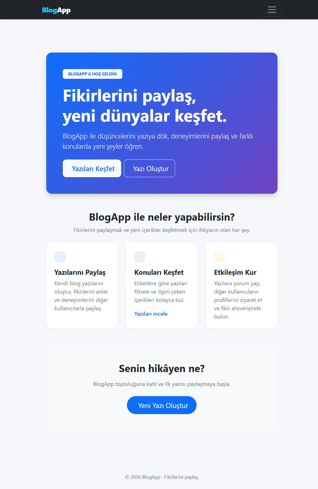
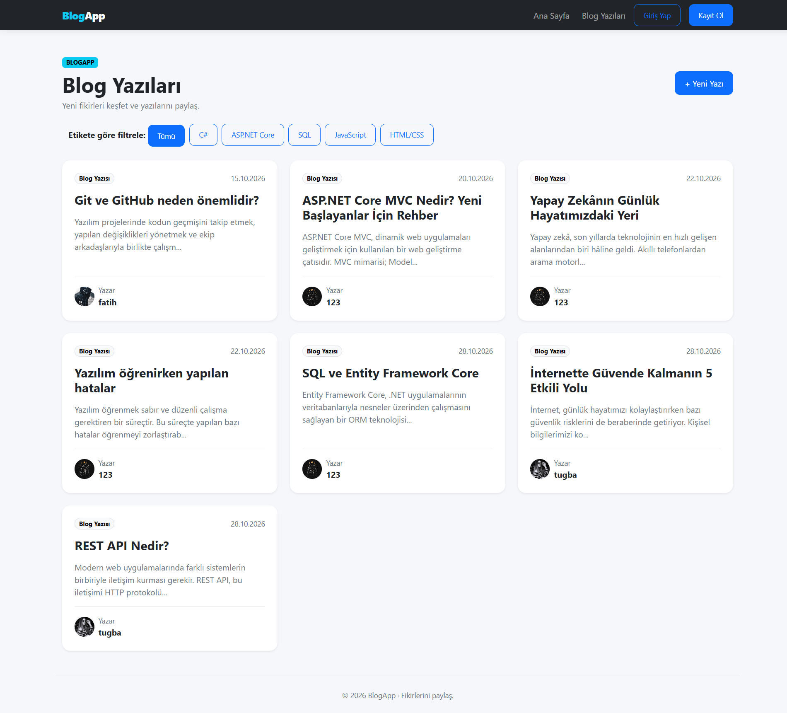
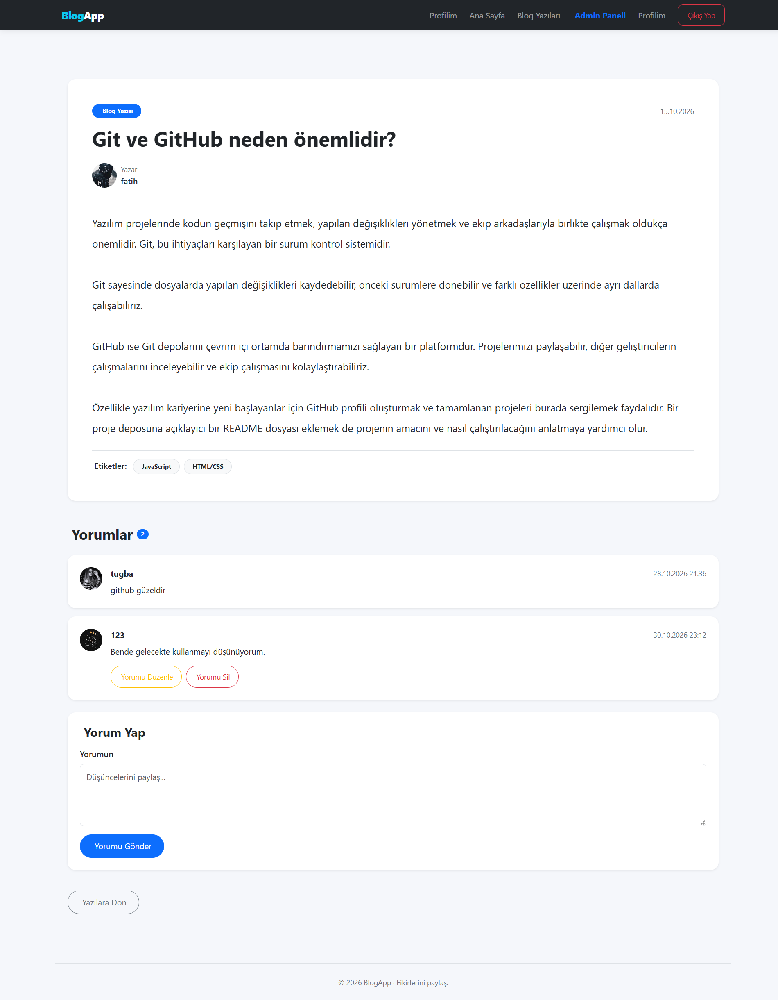
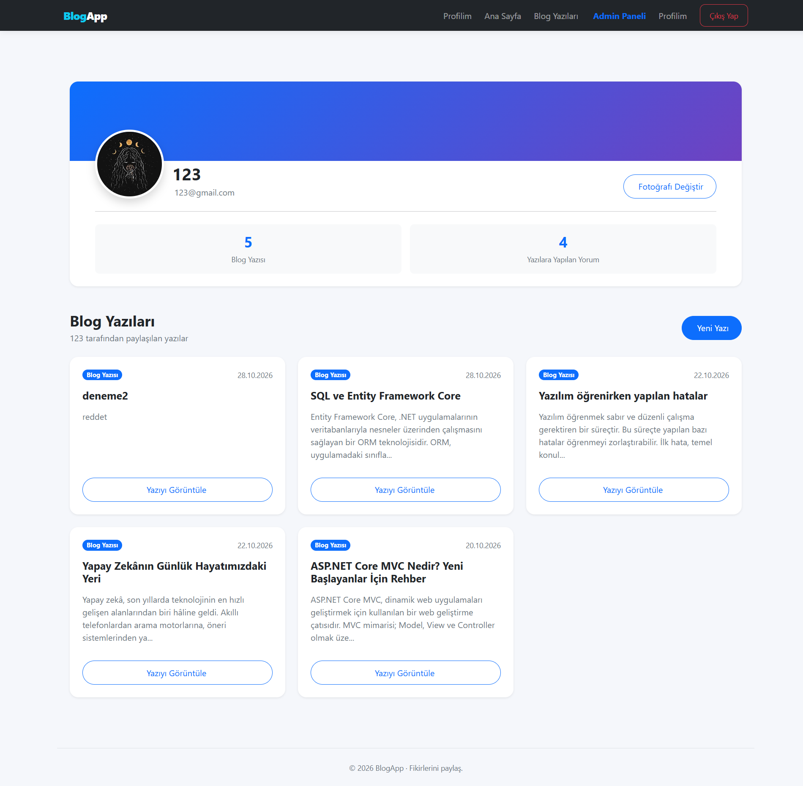
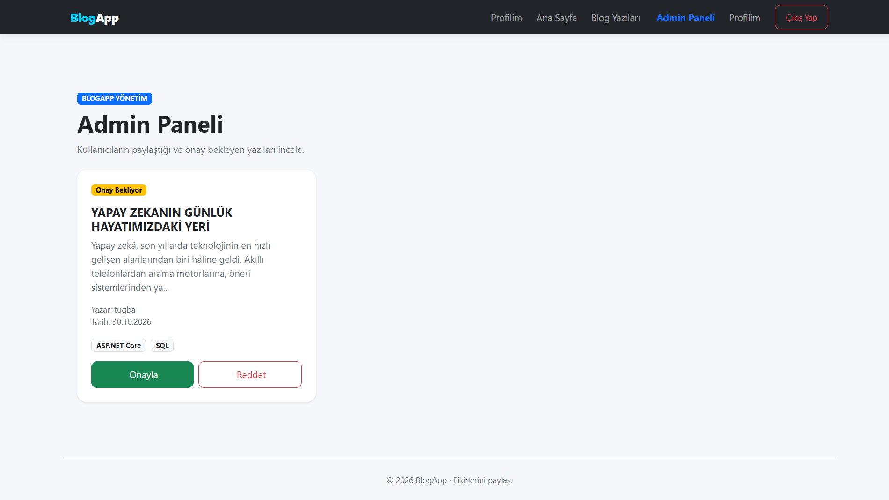

# BlogApp

BlogApp, kullanıcıların blog yazıları oluşturabildiği, paylaşabildiği ve diğer kullanıcıların yazılarına yorum yapabildiği ASP.NET Core MVC tabanlı bir blog uygulamasıdır.

Proje, kullanıcı yönetimi, rol bazlı yetkilendirme ve yönetici onay sistemi gibi özellikler içermektedir.

## Kullanılan Teknolojiler

- C#
- ASP.NET Core MVC (.NET 8)
- Entity Framework Core
- Microsoft SQL Server
- Bootstrap
- Cookie Authentication

## Özellikler

- Kullanıcı kayıt ve giriş sistemi
- Şifrelerin güvenli şekilde hashlenmesi
- Kullanıcı ve Admin rolleri
- Kullanıcı profilleri
- Profil fotoğrafı yükleme
- Blog yazısı oluşturma, düzenleme ve silme
- Blog yazılarına yorum yapma
- Etiket sistemi ve etiketlere göre filtreleme
- Admin tarafından blog yazılarını onaylama ve reddetme
- Admin tarafından kullanıcıların blog yazılarını yönetme
- Yetkilendirme ve erişim kontrolü

## Kurulum

### Gereksinimler

- .NET 8 SDK
- Microsoft SQL Server
- Entity Framework Core CLI
- Visual Studio Code veya Visual Studio

### Projeyi bilgisayara indirme

```bash
git clone REPOSITORY_URL
cd BlogApp
```

### Bağımlılıkları yükleme

```bash
dotnet restore
dotnet tool install --global dotnet-ef
```

### Veritabanı bağlantısı

BlogApp, Microsoft SQL Server kullanmaktadır.

Projeyi çalıştırmadan önce kendi SQL Server bağlantı bilgilerinizi yapılandırmanız gerekir.

1. SQL Server Management Studio (SSMS) üzerinden SQL Server bağlantınızı kontrol edin.
2. Projenin `appsettings.example.json` dosyasını inceleyin.
3. Kendi bilgisayarınıza uygun SQL Server bağlantı bilgilerini `appsettings.json` dosyasına ekleyin.
4. Gerçek bağlantı bilgilerinizi herkese açık GitHub reposuna yüklemeyin.

Örnek bağlantı ayarları için `appsettings.example.json` dosyasını inceleyebilirsiniz.

### Veritabanını oluşturma

Projenin ana klasöründe terminal açarak aşağıdaki komutu çalıştırın:

```bash
dotnet ef database update
```

Bu komut, mevcut Entity Framework Core migration dosyalarını kullanarak veritabanını oluşturur veya günceller.

### Uygulamayı çalıştırma

```bash
dotnet run
```

Terminalde gösterilen yerel adres üzerinden uygulamaya erişebilirsiniz.

## Ekran Görüntüleri

### Ana Sayfa


### Blog Yazıları


### Blog Detayları


### Kullanıcı Profili


### Admin Paneli


## Proje Hakkında

Bu proje, ASP.NET Core MVC, Entity Framework Core ve SQL Server teknolojileri kullanılarak geliştirilmiş bir öğrenme ve uygulama projesidir.